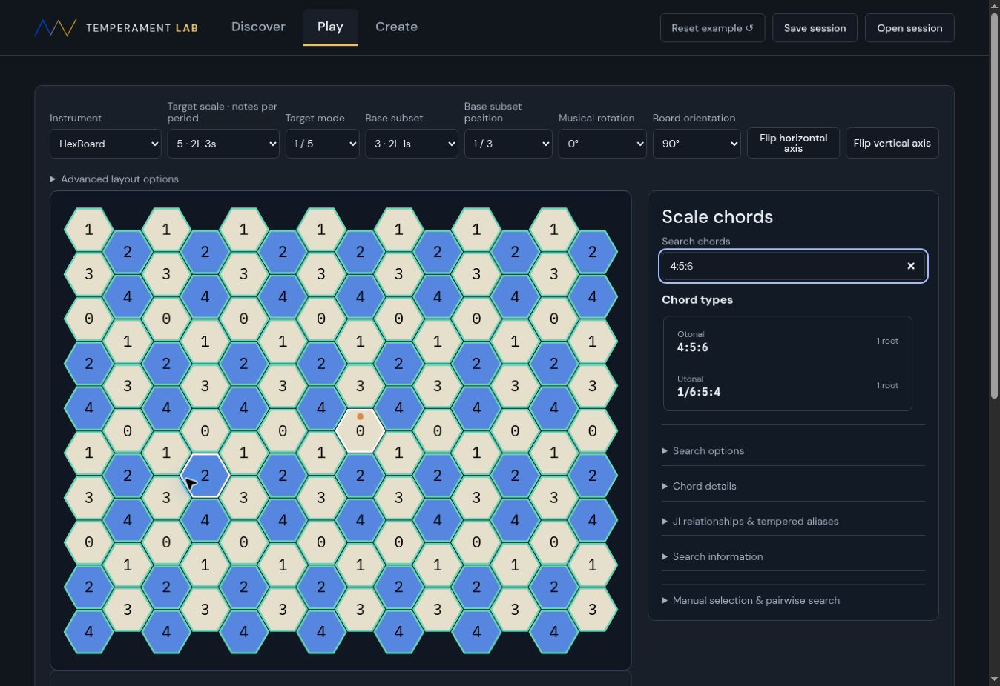

# Foundation regression pass

Completed 26 September 2026, America/Toronto (27 September UTC).
Baseline: `13a416d89ebd21d3d93c4562f5b54b172ff24cc8`.

## Result

All 39 automated suites pass. `npm run build` passes (51 app assets).
Focused browser checks on the local Sites preview pass after the fixes below.
The final browser sequence produced no application console errors.

| Area | Evidence | Result |
| --- | --- | --- |
| Central odd/prime limits | `ji-limit-engine.mjs`, `shared-ji.mjs`, chord discovery, manual chord and HexBoard suites; live Play filters set to odd 13 / prime 3 appeared unchanged in Discover | Pass |
| Basis defaults | Actual app settings tested for 2.3.5, 2.3.5.11, and 3.5.7; odd default 15; Porkypine excludes 7/4 until an explicit 11-prime-limit override; manual override and unset filter retained | Pass |
| Matrix / JI spans | `octave-matrix.mjs`, `tonality-diamond.mjs`, expanded `analysis-workspace.mjs`; live Diaschismic target span changed to octave and appeared as octave in Matrix; reverse change also persisted | Pass |
| Non-octave periods | 128/125, 2048/2025, 245/243 lattice, tuning, EDO, scale and wrapping checks; live 245/243 on 3.5.7 generated a 1901.9550-cent period and offered no invalid octave expansion | Pass |
| Mouse audio | Browser click/drag updated the selected tritave key and released its visual state; real pointer handler, HexBoard workspace and audio engine integrated in `audio.mjs` tests with wrapping on/off, pitch-frequency assertions, drag release, and Shift sustain | Pass within verification limits below |
| Chord typing / errors | Live sequential typing retained `4:5:6`, focus and caret; `0:5:6` showed a validation message; `1/6:5:4` recovered without an alert; catalogue suites cover valid, invalid, and outside-basis searches | Pass |
| Compare retirement | Only Discover / Play / Create remain; legacy two-temperament session tests restore the primary temperament and remap obsolete views; Discover-to-Play handoff and target detail rendering now exercised directly | Pass |

## Failures fixed

1. **Discover-to-Play handoff:** “Use scale in Play” called the removed
   `hexWorkspace.open()` method. Browser reproduction threw a TypeError and stayed
   in Discover. Removed that call and tested the actual click handler against the
   current workspace API, including scale/mode transfer and navigation.
2. **JI target details:** `diamondDetails()` used the removed comparison panel
   variable `idx`. The diamond could render before its details threw a ReferenceError;
   applying commas in that view could also display this as a preset error. Removed
   that dependency. Detail rendering now runs in tests for all three approximation
   sources, all display filters, both span choices, and ordinary, subgroup,
   divided-octave and tritave states.
3. **CSS acceptance snapshot:** the intentional removal of Analysis heading styles
   had not been recorded in the retained-cascade hash. Updated the snapshot to match
   the approved change. Existing semantic style assertions remain in place.

Also removed an unused A/B label variable and the remaining dead difference-view
condition in the controller.

## Verification limits

- Audio is verified by mouse interactions, voice lifecycle tests and oscillator
  frequency assertions. This pass did not include subjective listening or a physical
  HexBoard test.
- Saved-preset server APIs are unavailable in the local Vite preview and were not
  part of this pass. Session compatibility was tested with repository fixtures.
- This is a bounded regression checkpoint, not proof for every custom mapping or
  possible input. No new subsystem was added.

